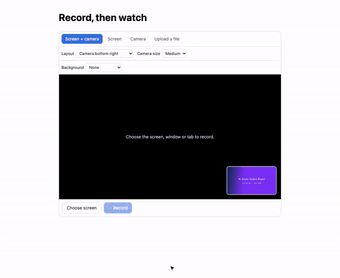

# Recorder (Node + Express)

[](../media/recorder-demo.mp4)

Let people record their screen or camera (or pick a file) on your page with `<video-piper-recorder>`, then play the result with `<video-piper>`. A small Express server keeps your API key off the page:

- `POST /api/upload-token` calls [`POST /upload-tokens`](https://videopiper.com/docs/recorder/) and returns a short-lived token that can upload exactly one video.
- `GET /api/videos/:id/links` returns the player's signed links, cached per video so you stay inside the API's rate limit.
- `public/index.html` shows the recorder and, after `vp-ready`, the player.

## Run it

```sh
npm install
cp .env.example .env        # then put your API key in .env
npm start                   # http://localhost:3000
```

With a test key (`vp_test_...`) recordings become free, marked, 480p videos of at most 60 seconds. Recording the screen or camera needs a Pro or Scale plan for live keys; picking a file works on every plan.

Settings (all in `.env`): `VIDEO_PIPER_API_KEY` (required), `VIDEO_PIPER_API_URL` (default `https://api.videopiper.dev/v1`), `VIDEO_PIPER_SITE_URL` (where the web component scripts come from, default `https://videopiper.com`), `PORT`.

## Before you use this in a real app

This demo has no sign-in, so anyone who can reach it can create upload tokens and read any video's links on your account. Authenticate your users before handing out a token or links, and put their id in the token's `metadata` so you can tell whose recording it is in webhooks. If your page is on a domain you have locked with [allowed domains](https://videopiper.com/docs/embed/#allowed-domains), add it there too.
